# CommunityServicePlatforms
社区服务平台 亮点：加权协同过滤推荐、Jieba中文词频分析、WebSocket实时聊天、求助处理闭环、 活动积分闭环、ECharts多维分析；

所有源码均本人开发，项目是前后端分离的，所有的项目都具备了完整的业务逻辑，不仅仅局限于基础的增删改查（CRUD）操作，系统亮点众多。

本文注重于计算机毕业设计选题指导，列出题目均有源码， 大家可以去【公众号】(毕业终点站)获取或者加我【qq】(2112698948)提意见(别忘记Star哟)。备注：git

声明：仅用于学习使用，请勿用于任何商业行为！

1.系统非商用，非开源，非无偿。

2.由本人开发，如需源码，请联系以下方式，qq:2112698948。

3.项目有很多，并未全部上传，如果未找到想要的，可直接咨询。

# 社区服务平台

> 面向小区日常事务的一套 Web 系统：住户在网页端看公告、逛论坛、报名活动、提交求助、兑换积分，社区管理员跟进求助和活动，超级管理员管基础数据与各类审核。三角色各用各的入口，数据在同一套后台里流转。

## 一、系统亮点

**1. 加权协同过滤推荐**
先找与当前帖子有共同点赞、收藏行为的住户，点赞记 2 分、收藏记 3 分，再按相似度推荐相关内容；推荐数量不够时，用同板块和全站热门帖子补齐。帖子详情页右侧的「猜你喜欢」就是这条逻辑的出口。

**2. Jieba 中文词频分析**
对帖子标题、正文和评论做中文分词，过滤掉停用词、数字和标点，按词频生成词云，社区最近在聊什么一眼就能看出来。词云放在社区管理员的论坛数据分析里，和帖子量、互动量一起看。

**3. WebSocket 实时聊天**
住户之间、住户与社区管理员之间都能一对一在线交流，带历史会话列表和未读提醒。邻里之间借个东西、问个事，不用先加微信。

**4. 求助处理全流程**
住户按分类和紧急程度提交求助（带位置信息），管理端轮询新求助并弹窗加声音提醒；处理时记录处置结果，处理完由住户评价。一条求助从提交、处置到评价都有留痕，不会石沉大海。

**5. 活动积分全流程**
活动方案审核通过后开放报名与签到，签到得积分，积分到积分商城换礼品，管理员发放礼品并维护兑换状态。社区参与变成可累计的积分，住户有反馈，运营也有抓手。

**6. ECharts 多维分析**
首页看板和管理端分析页把活动、论坛、居民服务的统计放在一起：活动趋势、分类分布、报名签到、互动排行、预算与评分都有对应图表，社区运营情况不用再靠翻表格。

## 二、技术选型

| 层次 | 技术 |
| --- | --- |
| 架构 | B/S、MVC、前后端分离（住户网页端 + 管理后台） |
| 开发环境 | Windows、IDEA、JDK 17、Maven、MySQL、Node.js |
| 后端 | Java、Spring Boot 3、Spring MVC、MyBatis-Plus、MySQL、JWT、WebSocket、Jieba 中文分词 |
| 前端 | Vue 3、Vite、Element Plus、Vue Router、Pinia、Axios、ECharts、词云图、AiEditor 富文本编辑器 |
| AI 能力 | 后端对接 DeepSeek，为富文本编辑提供内容生成与润色，模型密钥由后端统一管理 |

## 三、角色与功能

| 角色 | 主要功能 |
| --- | --- |
| 超级管理员 | 数据仪表盘；住户、社区管理员、小区、公告与轮播图维护；帖子审核、板块分类、敏感词库；活动方案审核与预算；特殊人员档案、家属信息、补贴审批、房主认证审核；议事投票与积分商品、库存管理 |
| 社区管理员 | 帖子发布与审核、活动方案提出、报名与签到管理；紧急求助按分类与等级处置并查看评价；特殊人群关怀记录与签到；在线聊天、意见反馈归档、积分礼品发放；活动 / 论坛 / 居民服务数据分析 |
| 住户 | 注册登录与个人中心、积分余额；社区首页、公告轮播；论坛发帖、评论、点赞收藏与相关推荐；活动报名签到、议事投票；房主认证与房屋租赁；分类求助与意见反馈；补贴申请、积分兑换；一对一实时聊天 |

## 四、系统截图

> 源文档共 20 张截图，这里挑选 13 张核心页面，按三角色分区展示；房屋租赁、议事投票、帖子管理、反馈管理、活动列表与报名等页面未全部列出，功能已在上方角色表覆盖。

### 住户端

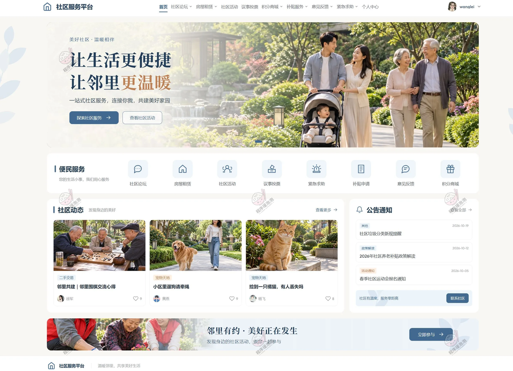

**首页**：顶部是社区服务入口，下面依次是便民服务九宫格、社区动态（帖子卡片）、公告通知与社区活动横幅。

<table>
<tr>
<td width="50%">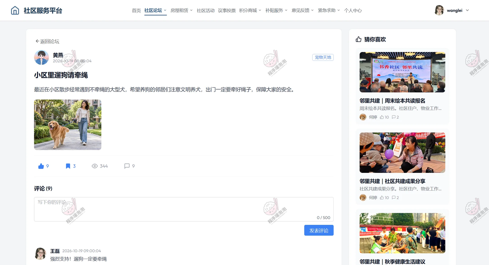</td>
<td width="50%">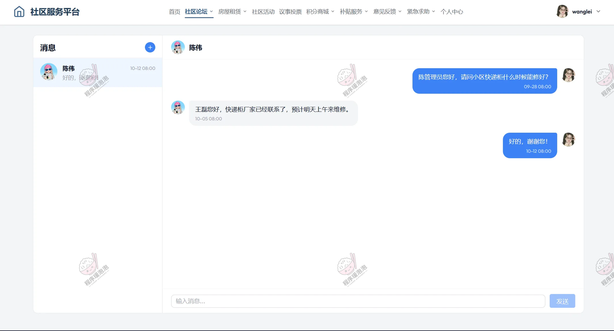</td>
</tr>
<tr>
<td><strong>论坛详情 · 猜你喜欢推荐</strong> 左侧是帖子正文、点赞收藏与评论，右侧「猜你喜欢」按协同过滤结果推送相关帖子。</td>
<td><strong>社区交流 · 实时聊天</strong> 左侧会话列表带未读标记，右侧是一对一聊天窗口，基于 WebSocket 实时收发。</td>
</tr>
</table>

<table>
<tr>
<td width="50%">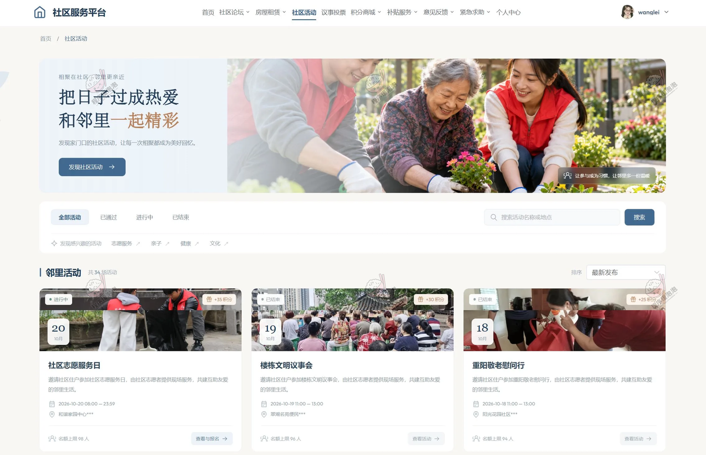</td>
<td width="50%">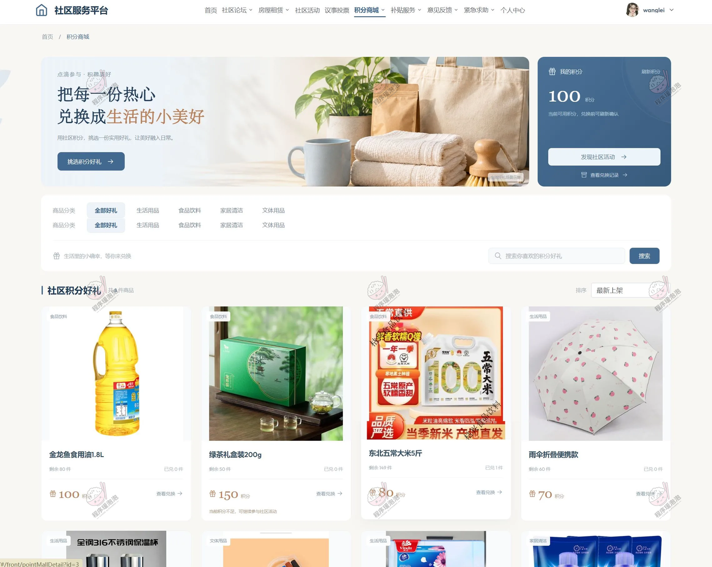</td>
</tr>
<tr>
<td><strong>社区活动 · 报名与签到</strong> 顶部按已通过、进行中、已结束切换，卡片上标着活动积分、时间地点和剩余名额，直接进报名。</td>
<td><strong>积分好礼 · 积分兑换</strong> 积分余额在顶部，礼品按积分标价，兑换后可在记录里查状态。</td>
</tr>
</table>

### 社区管理员端

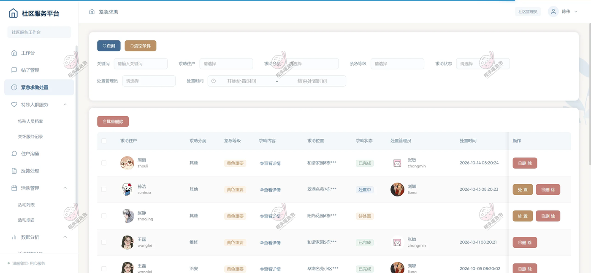

**紧急求助处置**：按分类、紧急等级（黄色重要、红色紧急）和状态（待处理 / 处理中 / 已完成）筛选求助单，表格里能看到求助住户、求助位置、处理管理员和处理时间；点开记录处置结果，详情里可以看住户评价。

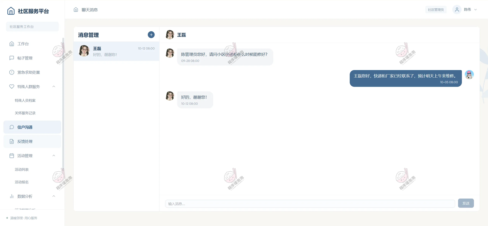

**住户沟通**：管理端的聊天工作台，左侧是住户会话与未读数量，右侧对话区可发送文字，和住户端共用同一套 WebSocket 通道。

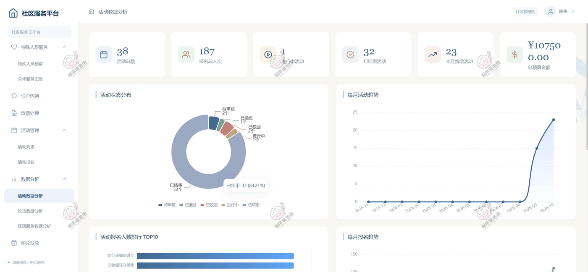

**数据分析**：上方六个指标卡（活动场次、报名人次、进行中、已结束、本月新增、预算金额），下面是活动状态环图、每月活动趋势、报名人数 TOP10 与每月报名趋势。

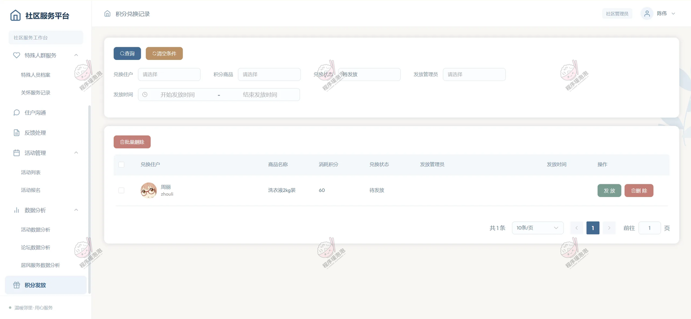

**积分发放**：兑换记录里列出住户、商品名称、消耗积分和兑换状态；管理员核对后点「发放」，状态从待发放改为已发放，同时记下发放管理员和时间，无效记录可直接删除。

### 超级管理员端

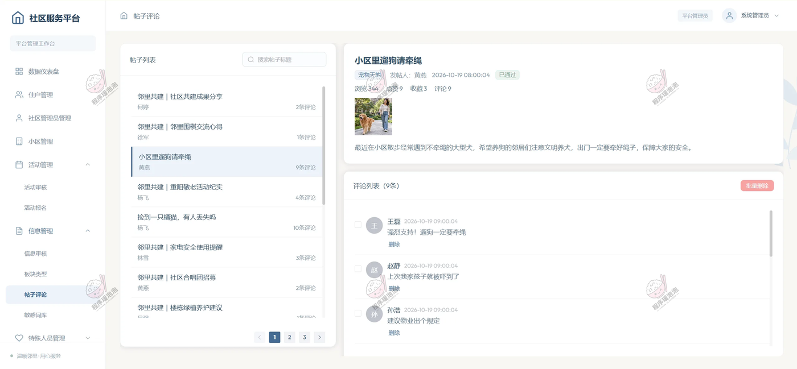

**帖子评论**：三栏布局，左边是带评论数的帖子列表，右上展示帖子正文、板块和审核状态，右下是评论列表，支持批量删除，违规内容在同一屏里就能处理。

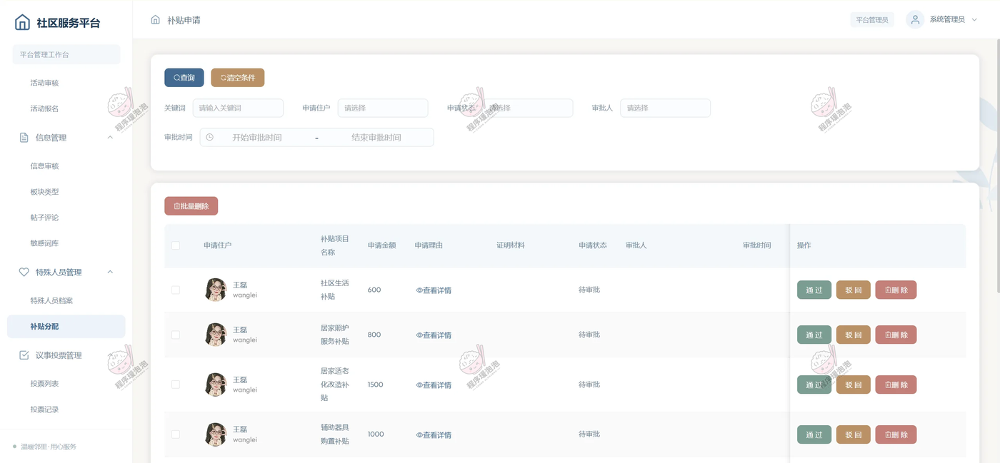

**补贴分配**：申请列表按补贴项目分组展示，每条都带申请金额、申请理由和证明材料，管理员逐条通过或驳回，审批人和审批时间自动留痕。

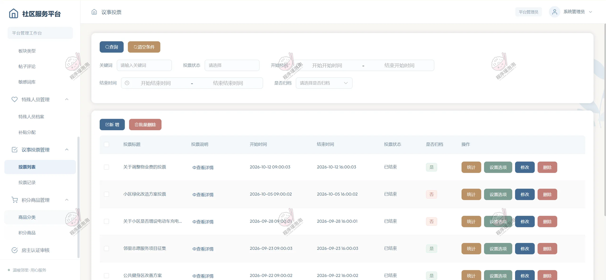

**投票列表**：表格里能看到投票标题、说明、起止时间和是否归档；「统计」看投票结果，「设置选项」维护候选项，结束的投票可以归档留档。

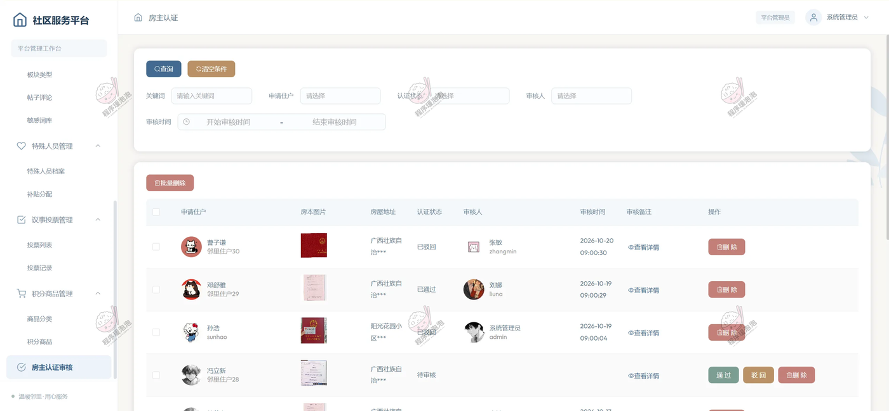

**房主认证审核**：住户提交房产证明后进入待审列表，管理员核对楼栋房号与材料，通过后住户才能发布出租信息。

---

文档展示 13 张截图，需要了解更多，请联系我。

